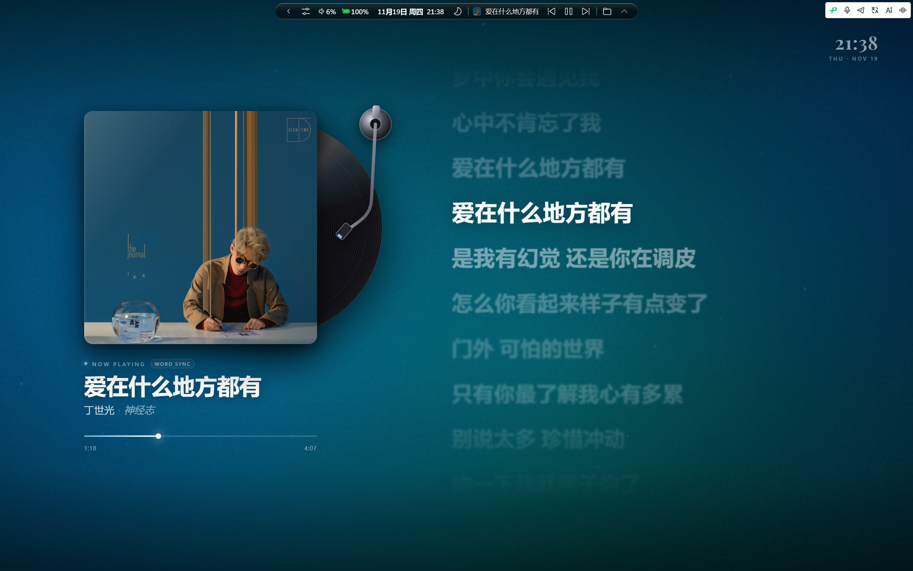

# Vinyl Now Playing — Apple Editorial Live Wallpaper

<p align="center">
  
</p>

一款基于 **Lively Wallpaper** 与 **Windows SMTC（系统媒体控制）** 的免费开源桌面动态音乐壁纸。  
无需任何 Spotify / Last.fm API Key，原生兼容 **MyGo Music**、网易云音乐、Apple Music、Spotify、浏览器音频等所有接入 Windows 媒体控制的播放器，在桌面上呈现 **黑胶唱片舞台 + Apple Music 级逐字浮动歌词 + 动态取色流体背景**。

---

## 核心特性

- **Apple Music 官方动态封面**：切歌时自动检索并无缝淡入播放 Apple Music 官方 1:1 `.mp4` 动态专辑封面；无动态封面的专辑自动升级至 1200×1200 / 1000×1000 高清封面并附带轻柔 2.5D 呼吸感。
- **毫秒级逐字浮动歌词**：
  - 优先拉取网易云 **YRC 逐字时间戳 + 双语翻译**，无 YRC 时自动回退至 `lrclib.net` 并按中英文词长合成流畅逐字节奏。
  - 60fps 逐字从左向右高亮扫光、微幅上浮泛光、景深渐进虚化，以及纯音乐前奏呼吸三点提示。
  - 英文默认采用 **Playfair Display** 杂志衬线体，中文默认采用清晰锐利的现代无衬线体（内置霞鹜文楷与华文中宋可选）。
- **流体光影背景 & 黑胶细节**：
  - 60fps Canvas **5 色流体极光网格**（从封面四象限提取主色并做深丝绒底色偏移），叠加随音频能量呼吸的微尘光斑、35mm 胶片颗粒与唱片同心微光环。
  - 博朗（Braun）风格阳极氧化铝唱臂：播放时落针在唱片沟槽，暂停时抬臂归位并收起黑胶。
- **桌面直接交互**：
  - **拖动/点击进度条**：鼠标悬停自动加粗并显示时间预览，松手即跳转，歌词 0ms 即时跟进。
  - **点词跳转**：点击右侧任意一句歌词直接跳到该句演唱时间点。
  - **悬停控制条**：鼠标停在封面底部浮现半透明 上一首 / 播放暂停 / 下一首 控制胶囊，移开自动隐身。
- **多线程并发桥接（零阻塞）**：8 线程 `RunspacePool` 本地服务（`127.0.0.1:28973`），切歌时自带旧时间轴拦截保护，避免进度条停留在上一首歌的旧进度。

---

## 快速安装（新电脑一键部署）

### 环境准备
1. Windows 10 / 11
2. 安装并打开过一次 [**Lively Wallpaper**](https://github.com/lively-community/lively/releases)（免费开源）：
   ```powershell
   winget install rocksdanister.LivelyWallpaper
   ```

### 一键部署
```powershell
git clone https://github.com/SuperSpiderBoy/vinyl-now-playing.git
cd vinyl-now-playing
powershell -ExecutionPolicy Bypass -File .\install.ps1
```

脚本会自动完成：
1. 将壁纸与本地字体包部署到 `%LOCALAPPDATA%\Lively Wallpaper\Library\wallpapers\vinyl.nowplaying`
2. 将同步桥接脚本部署到 `%LOCALAPPDATA%\VinylNowPlaying\scripts\`
3. 注册并启动开机自启计划任务 `VinylSyncBridge`（静默隐藏运行）

最后打开 **Lively Wallpaper**，点击 **「Vinyl Now Playing (专辑黑胶)」** 即可应用；建议在 Lively 设置中开启「随 Windows 启动」并将「壁纸交互」设为鼠标（`InputForward: Mouse`）以支持桌面拖动进度条。

---

## 个性化定制

在 Lively Wallpaper 中右键该壁纸 → **「自定义壁纸」**，可实时调整以下选项：

| 选项 | 说明 |
|---|---|
| **歌词字体** | 衬线英文 × 原版中文（默认） / 文楷 × 衬线 / 杂志中宋 |
| **Apple Music 动态封面** | 开关官方 `.mp4` 动态专辑封面 |
| **黑胶唱臂动画 / 黑胶旋转** | 开关金属唱臂落针与黑胶转动 |
| **双语歌词翻译** | 开关网易云双语译文行 |
| **背景微尘光斑 / 胶片颗粒** | 开关氛围漂浮粒子与 35mm 噪点质感 |
| **右上角极简时钟** | 开关右上角日期与时间显示 |
| **音频微光律动** | 开关背景网格与光晕随系统音频呼吸 |
| **歌词字号缩放** | `85%` – `125%` 自由缩放 |

---

## 项目结构

```text
vinyl-now-playing/
├── assets/
│   └── preview.png               # 桌面实拍效果预览
├── scripts/
│   ├── sync_bridge.ps1           # 多线程 Windows SMTC + 动态封面 + 歌词桥接服务
│   └── start_bridge.vbs          # 无窗口静默启动器
├── wallpaper/
│   ├── fonts/                    # 本地打包的 Playfair Display & LXGW WenKai 字体
│   ├── index.html                # 壁纸前端主舞台（Canvas 流体网格 + 黑胶 + 逐字歌词）
│   ├── LivelyInfo.json           # Lively 壁纸清单（启用 --system-nowplaying --audio）
│   ├── LivelyProperties.json     # Lively 自定义面板配置
│   └── thumbnail.png             # 壁纸缩略图
├── install.ps1                   # 新设备一键部署脚本
├── uninstall.ps1                 # 一键卸载清理脚本
└── LICENSE                       # MIT License
```

---

## 卸载与常见问题

- **一键卸载清理**：
  ```powershell
  powershell -ExecutionPolicy Bypass -File .\uninstall.ps1
  ```
- **检查桥接服务是否正常运行**：浏览器访问 `http://127.0.0.1:28973/state` 或 `http://127.0.0.1:28973/debug`。
- **Lively 无法挂载到桌面背景**：请勿以“管理员身份”启动 Lively，否则无法挂载至普通权限的桌面 `WorkerW` 图层。
- **播放器内拖动进度条延迟**：部分第三方播放器（如 MyGo Music）自身每 2~3 秒才向 Windows SMTC 推送一次进度更新；建议直接拖动桌面壁纸上的进度条或点击歌词行，可实现 0ms 即时同步。

---

## Credits

- Wallpaper host: [Lively Wallpaper](https://github.com/lively-community/lively)
- Fonts bundled locally: [Playfair Display](https://fonts.google.com/specimen/Playfair+Display) & [LXGW WenKai](https://github.com/lxgw/LxgwWenKai)
- Lyrics providers: NetEase Cloud Music & [LRCLIB](https://lrclib.net/)
